<!-- for whoever pays attention: the best interfaces are love letters in disguise ✨ -->

  

  

  
  
  
  

 

<table>
<tr>
<td width="61%" valign="top">

### <code>&gt; Who Am I</code>

I'm **Imen** — a software engineer who believes code should be as thoughtful as it is functional.

I build full-stack products where clean architecture meets interfaces that make people stop scrolling. From AI-powered backends to design systems obsessed with the last pixel, I care about the details most people never notice — and the feeling they can't forget.

 

- 🌌 &nbsp;Building **real-time fintech experiences** with Angular, .NET 8 & SignalR
- 🤖 &nbsp;Exploring **AI automation** and intelligent workflows
- 🎨 &nbsp;Designing **accessible, dark-mode-first interfaces**
- ☕ &nbsp;Fueled by espresso, synthwave and late-night playlists

</td>
<td width="39%" valign="top">
  
</td>
</tr>
</table>

 

   
  <i>"I don't just ship code — I ship the feeling of things working beautifully."</i> 
  systems thinker &nbsp;·&nbsp; detail maximalist &nbsp;·&nbsp; midnight builder

 

<h3 align="center">✦ &nbsp; the arsenal &nbsp; ✦</h3>

  

  
  
  
  
  
  

 

<table align="center">
<tr>
<td align="center" width="33%">
  <h4>⚙️ &nbsp;engineered</h4>
  scalable APIs · clean architecture real-time systems · CI/CD
</td>
<td align="center" width="33%">
  <h4>🎨 &nbsp;designed</h4>
  design systems · micro-interactions dark-mode-first UI
</td>
<td align="center" width="33%">
  <h4>♿ &nbsp;human</h4>
  accessibility · clarity empathy in every flow
</td>
</tr>
</table>

 

<h3 align="center">✧ &nbsp; selected universes &nbsp; ✧</h3>

<table>
<tr>
<td width="50%" valign="top">

**🏦 [BT DocCenter](https://github.com/imenbouchriha12/BT_DossierBackend)** &nbsp;·&nbsp; [frontend](https://github.com/imenbouchriha12/BT_DossierFront) 
A real-time banking document hub — OCR, AI-assisted fraud detection, SSIS pipelines and live notifications.  

</td>
<td width="50%" valign="top">

**📨 [Smiters.io](https://github.com/imenbouchriha12/smiters.io)** 
An AI email co-pilot that writes client-ready replies from incoming mail — engineered, containerized, shipped.  

</td>
</tr>
<tr>
<td width="50%" valign="top">

**🧭 [PI Platform](https://github.com/imenbouchriha12/PI_Front)** &nbsp;·&nbsp; [backend](https://github.com/imenbouchriha12/PI_Back) 
A full-stack management platform with JWT auth, PDF reports, scheduled jobs and a themeable, accessible React UI.  

</td>
<td width="50%" valign="top">

**🚗 [AutoFlow](https://github.com/imenbouchriha12/GestionVoiture_NestJs)** 
Real-time vehicle management with Socket.io and MongoDB — dashboards that update the moment data changes.  

</td>
</tr>
<tr>
<td width="50%" valign="top">

**☕ [Café Manager](https://github.com/imenbouchriha12/GestionCofee-SpringBoot)** 
A Spring Boot system for café operations — products, orders and stock flowing through one clean interface.  

</td>
<td width="50%" valign="top">

**✨ [Lumina](https://imen-bouchriha.netlify.app/)** &nbsp;·&nbsp; [source](https://github.com/imenbouchriha12/Imen-s_Portfolio) 
A design-forward portfolio and playground for motion, typography and dark-mode aesthetics — live on the web.  

</td>
</tr>
</table>

 

<h3 align="center">◈ &nbsp; signal from the grid &nbsp; ◈</h3>

  
  

  

  

  <picture>
    <source media="(prefers-color-scheme: dark)" srcset="https://raw.githubusercontent.com/imenbouchriha12/imenbouchriha12/output/github-snake-dark.svg" />
    <source media="(prefers-color-scheme: light)" srcset="https://raw.githubusercontent.com/imenbouchriha12/imenbouchriha12/output/github-snake.svg" />
    
  </picture>

  the snake feeds on my commits — refreshed every 12 hours 🐍

 

<h3 align="center">☾ &nbsp; beyond the code &nbsp; ☾</h3>

<table align="center">
<tr>
<td align="center" width="25%">🎨 <b>design systems</b> tokens · type · rhythm</td>
<td align="center" width="25%">🌙 <b>dark mode</b> a way of life</td>
<td align="center" width="25%">♿ <b>accessibility</b> beauty for everyone</td>
<td align="center" width="25%">🧠 <b>AI × UX</b> tools that feel human</td>
</tr>
</table>

 

<h3 align="center">✉ &nbsp; find me in the wild &nbsp; ✉</h3>

  
  
  
  

   
  <i>Open to ambitious projects, creative collaborations & good conversations.</i> 
  Let's make something people remember.

 

  

