<!-- for whoever pays attention: the best interfaces are love letters in disguise ✨ -->

  

  <picture>
    <source media="(prefers-color-scheme: dark)" srcset="https://raw.githubusercontent.com/imenbouchriha12/imenbouchriha12/output/status-dark.svg" />
    <source media="(prefers-color-scheme: light)" srcset="https://raw.githubusercontent.com/imenbouchriha12/imenbouchriha12/output/status-light.svg" />
    
  </picture>

 

<table>
<tr>
<td width="61%" valign="top">

### <code>01 · WHO AM I</code>

> I design and build real-time products that feel alive — clean architecture on the inside, interfaces with a pulse on the outside.

Software engineer, full-stack by range, detail-obsessed by default. From AI-assisted banking workflows to design systems obsessed with the last pixel, I care about the details most people never notice — and the feeling they can't forget.

 

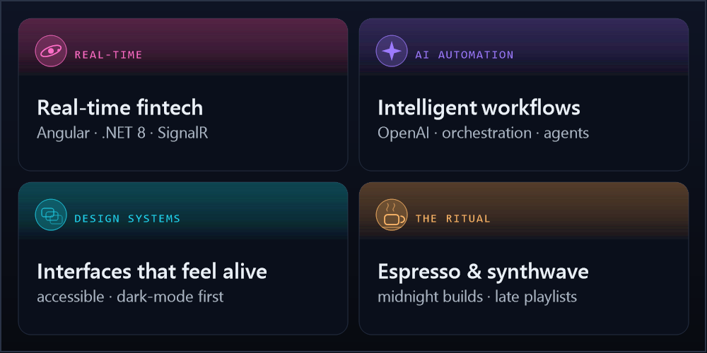

</td>
<td width="39%" valign="top">
  
</td>
</tr>
</table>

 

   
  <i>"I don't just ship code — I ship the feeling of things working beautifully."</i> 
  systems thinker &nbsp;·&nbsp; detail maximalist &nbsp;·&nbsp; midnight builder

 


 

<h3 align="center">✧ &nbsp; selected universes &nbsp; ✧</h3>

six products, six little worlds — each one designed, built and shipped end-to-end.

<table>
<tr>
<td width="50%" valign="top">
  
</td>
<td width="50%" valign="top">
  
</td>
</tr>
<tr>
<td width="50%" valign="top">
  
</td>
<td width="50%" valign="top">
  
</td>
</tr>
<tr>
<td width="50%" valign="top">
  
</td>
<td width="50%" valign="top">
  
</td>
</tr>
</table>

 

<h3 align="center">◈ &nbsp; signal from the grid &nbsp; ◈</h3>

live telemetry rendered from my own commits, inside this repo — refreshed every 12 hours.

  <picture>
    <source media="(prefers-color-scheme: dark)" srcset="https://raw.githubusercontent.com/imenbouchriha12/imenbouchriha12/output/stats-dark.svg" />
    <source media="(prefers-color-scheme: light)" srcset="https://raw.githubusercontent.com/imenbouchriha12/imenbouchriha12/output/stats-light.svg" />
    
  </picture>
  <picture>
    <source media="(prefers-color-scheme: dark)" srcset="https://raw.githubusercontent.com/imenbouchriha12/imenbouchriha12/output/languages-dark.svg" />
    <source media="(prefers-color-scheme: light)" srcset="https://raw.githubusercontent.com/imenbouchriha12/imenbouchriha12/output/languages-light.svg" />
    
  </picture>

  <picture>
    <source media="(prefers-color-scheme: dark)" srcset="https://raw.githubusercontent.com/imenbouchriha12/imenbouchriha12/output/streak-dark.svg" />
    <source media="(prefers-color-scheme: light)" srcset="https://raw.githubusercontent.com/imenbouchriha12/imenbouchriha12/output/streak-light.svg" />
    
  </picture>

  <picture>
    <source media="(prefers-color-scheme: dark)" srcset="https://raw.githubusercontent.com/imenbouchriha12/imenbouchriha12/output/skyline-dark.svg" />
    <source media="(prefers-color-scheme: light)" srcset="https://raw.githubusercontent.com/imenbouchriha12/imenbouchriha12/output/skyline-light.svg" />
    
  </picture>

  the city I build after midnight — one commit at a time, redrawn every 12 hours

 


 

<h3 align="center">✉ &nbsp; find me in the wild &nbsp; ✉</h3>

<table>
<tr>
<td width="50%" valign="top">
  <a href="mailto:imenbouchriha5@gmail.com">
    
  </a>
</td>
<td width="50%" valign="top">
  <a href="https://www.linkedin.com/in/bouchriha-imen-99077823b">
    
  </a>
</td>
</tr>
<tr>
<td width="50%" valign="top">
  <a href="https://github.com/imenbouchriha12">
    
  </a>
</td>
<td width="50%" valign="top">
  <a href="https://imen-bouchriha.netlify.app/">
    
  </a>
</td>
</tr>
</table>

   
  <i>Open to ambitious projects, creative collaborations & good conversations.</i> 
  Let's make something people remember.

 

  

<!-- view counter pixel: keeps the profile view count accurate; the band shows a 12-hour snapshot -->

