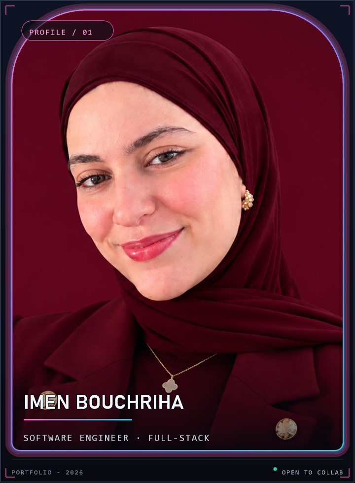

<!-- for whoever pays attention: the best interfaces are love letters in disguise ✨ -->

  

  
  
  

 

<table>
<tr>
<td width="61%" valign="top">

### <code>01 · WHO AM I</code>

> I design and build real-time products that feel alive — clean architecture on the inside, interfaces with a pulse on the outside.

Software engineer, full-stack by range, detail-obsessed by default. From AI-assisted banking workflows to design systems obsessed with the last pixel, I care about the details most people never notice — and the feeling they can't forget.

 

</td>
<td width="39%" valign="top">
  
</td>
</tr>
</table>

 

   
  <i>"I don't just ship code — I ship the feeling of things working beautifully."</i> 
  systems thinker &nbsp;·&nbsp; detail maximalist &nbsp;·&nbsp; midnight builder

 

<h3 align="center">✦ &nbsp; the arsenal &nbsp; ✦</h3>

  

<table align="center">
<tr>
<td align="center" width="33%" valign="top">
  <b>01 · INTERFACE</b>  
    
  design systems · motion accessible, dark-mode-first
</td>
<td align="center" width="33%" valign="top">
  <b>02 · ENGINE</b>  
    
  clean architecture · APIs real-time with SignalR &amp; sockets
</td>
<td align="center" width="33%" valign="top">
  <b>03 · FOUNDATIONS</b>  
    
  data modelling · CI/CD ship small, ship often
</td>
</tr>
</table>

 

  
  
  
  
  
  

  engineered · designed · human — the same three rules, every time.

 

<h3 align="center">✧ &nbsp; selected universes &nbsp; ✧</h3>

six products, six little worlds — each one designed, built and shipped end-to-end.

<table>
<tr>
<td width="50%" valign="top">
  
</td>
<td width="50%" valign="top">
  
</td>
</tr>
<tr>
<td width="50%" valign="top">
  
</td>
<td width="50%" valign="top">
  
</td>
</tr>
<tr>
<td width="50%" valign="top">
  
</td>
<td width="50%" valign="top">
  
</td>
</tr>
</table>

 

<h3 align="center">◈ &nbsp; signal from the grid &nbsp; ◈</h3>

live telemetry rendered from my own commits, inside this repo — refreshed every 12 hours.

  <picture>
    <source media="(prefers-color-scheme: dark)" srcset="https://raw.githubusercontent.com/imenbouchriha12/imenbouchriha12/output/stats-dark.svg" />
    <source media="(prefers-color-scheme: light)" srcset="https://raw.githubusercontent.com/imenbouchriha12/imenbouchriha12/output/stats-light.svg" />
    
  </picture>
  <picture>
    <source media="(prefers-color-scheme: dark)" srcset="https://raw.githubusercontent.com/imenbouchriha12/imenbouchriha12/output/languages-dark.svg" />
    <source media="(prefers-color-scheme: light)" srcset="https://raw.githubusercontent.com/imenbouchriha12/imenbouchriha12/output/languages-light.svg" />
    
  </picture>

  <picture>
    <source media="(prefers-color-scheme: dark)" srcset="https://raw.githubusercontent.com/imenbouchriha12/imenbouchriha12/output/streak-dark.svg" />
    <source media="(prefers-color-scheme: light)" srcset="https://raw.githubusercontent.com/imenbouchriha12/imenbouchriha12/output/streak-light.svg" />
    
  </picture>

  <picture>
    <source media="(prefers-color-scheme: dark)" srcset="https://raw.githubusercontent.com/imenbouchriha12/imenbouchriha12/output/github-snake-dark.svg" />
    <source media="(prefers-color-scheme: light)" srcset="https://raw.githubusercontent.com/imenbouchriha12/imenbouchriha12/output/github-snake.svg" />
    
  </picture>

  the snake feeds on my commits — telemetry and streak regenerate every 12 hours 🐍

 

<h3 align="center">☾ &nbsp; beyond the code &nbsp; ☾</h3>

<table align="center">
<tr>
<td align="center" width="25%">🎨 <b>design systems</b> tokens · type · rhythm</td>
<td align="center" width="25%">🌙 <b>dark mode</b> a way of life</td>
<td align="center" width="25%">♿ <b>accessibility</b> beauty for everyone</td>
<td align="center" width="25%">🧠 <b>AI × UX</b> tools that feel human</td>
</tr>
</table>

 

<h3 align="center">✉ &nbsp; find me in the wild &nbsp; ✉</h3>

  
  
  
  

   
  <i>Open to ambitious projects, creative collaborations & good conversations.</i> 
  Let's make something people remember.

 

  

